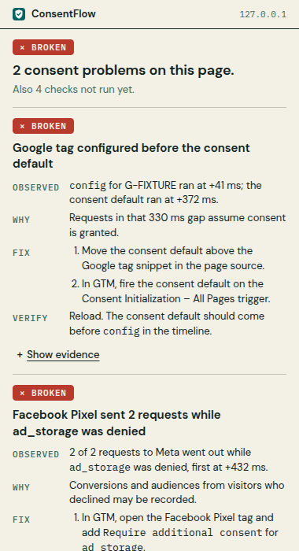
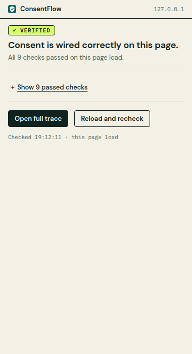
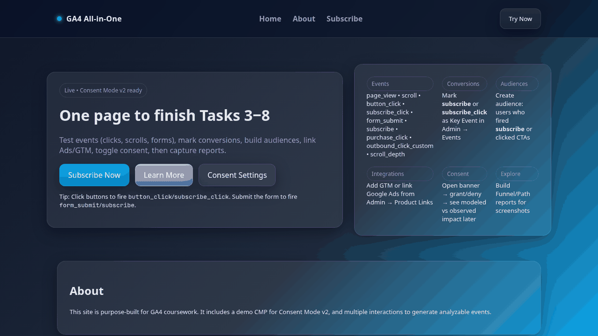

<p align="center">
  
</p>

<h1 align="center">ConsentFlow Debugger</h1>

<p align="center">
  <strong>Find the tags that fire before consent on any live page, and get the fix.</strong>
</p>

<p align="center">
  8 Consent Mode rules · 10 tags judged request by request · 10 consent platforms (CMPs) recognised · nothing leaves your browser
</p>

<p align="center">
  <a href="https://github.com/ChristopherLandaverde/ConsentFlow-Debugger/actions/workflows/ci.yml"></a>
  <a href="manifest.json"></a>
  <a href="LICENSE"></a>
</p>

<p align="center">
  <a href="#quick-start">Quick start</a> · <a href="#what-you-get">What you get</a> · <a href="#known-limits">Known limits</a> · <a href="#privacy-and-permissions">Privacy</a> · <a href="https://consentflow-psi.vercel.app">Landing page</a>
</p>

A Consent Mode setup can look right in GTM preview and still be wrong on the live page: the
consent default lands a few hundred milliseconds after `config`, a pixel fires before the
banner is answered, or the v2 fields `ad_user_data` and `ad_personalization` are missing.
Google's own guide is blunt about the first one: "If your consent code is called out of
order, consent defaults won't work"
([source](https://developers.google.com/tag-platform/security/guides/consent)). The cost is
requests sent for visitors who said no, and consent signals that Google's
[conversion modelling](https://support.google.com/google-ads/answer/10000067) relies on
being wrong.

ConsentFlow Debugger is a free, open-source Chrome extension that shows you this on the page
itself, in one click, with the fix for each problem.

<p align="center">
  
  
  <br><sub>Before and after, on the two sample pages bundled in <code>tests/fixtures/</code>. Left: the consent default arrives 330 ms after <code>config</code> and the Meta Pixel sends while <code>ad_storage</code> is denied. Right: the same checks once consent is wired correctly.</sub>
</p>

## Who it's for

- **Analytics engineers** verifying a Consent Mode change on staging or production before they call it done.
- **QA testers** reproducing a consent bug and filing it with the timings and requests as evidence.
- **Consultants** auditing a client's site from the browser, without access to their GTM container.

## What you get

| | |
|---|---|
| **A verdict in one sentence** | `× BROKEN`, `! REVIEW`, `– INCOMPLETE` or `✓ VERIFIED`, with the most severe problem underneath. Checks that couldn't run say so and why; they never count as passed. |
| **Every tag judged by the consent at the moment it sent** | A tag that sent a request while its consent was `denied` is a violation, even if the visitor accepted later. Covers GA4, GTM, Google Ads, Meta Pixel, LinkedIn, TikTok, Hotjar, Clarity, Pinterest and Snapchat. |
| **Ordering and setup mistakes, timed in milliseconds** | `config` before the consent default, an `update` before the default, a missing default, duplicate defaults, missing v2 fields, no `wait_for_update` when a CMP is present. |
| **A fix and a way to check it** | Every finding says what was observed, why it matters, how to fix it (page source and GTM) and what to look for after you reload. |
| **Google's consent signals decoded** | `gcs` and `gcd` on each Google request, side by side with the consent the page had when it was sent, flagged when they disagree. |

The full detection reference, including all eight rules and the tag verdicts, is in
[docs/detection.md](docs/detection.md).

## Quick start

Not published on the Chrome Web Store: you load it unpacked, with no build step. Requires
Chrome or another Chromium browser with Manifest V3 (Chrome 114+ for the side panel), and
Python 3.7+ to serve the sample pages.

```bash
git clone https://github.com/ChristopherLandaverde/ConsentFlow-Debugger.git
cd ConsentFlow-Debugger
python3 -m http.server 8000 -d tests/fixtures
```

1. In `chrome://extensions/`, turn on **Developer mode**, click **Load unpacked** and select
   the `ConsentFlow-Debugger` folder (the one with `manifest.json`).
2. Open <http://localhost:8000/popup-states.html?s=broken> and click the ConsentFlow icon.
   You should see `× BROKEN`, "2 consent problems on this page", starting with "Google tag
   configured before the consent default".
3. Open <http://localhost:8000/popup-states.html?s=verified>: the popup says "Consent is
   wired correctly on this page."
4. Now reload a page of your own and click the icon. Click **Open full trace** for the
   timeline, every request and the consent state in a side panel.

Content scripts don't run on `file://` pages, which is why the samples are served over
HTTP. No local server? The landing page's
[measurement test section](https://consentflow-psi.vercel.app/#measurement-playground) loads
a disposable GTM container. To update, `git pull` and click reload on the extension's card.
Release-zip install and a full tour of the popup and side panel:
[docs/usage.md](docs/usage.md).

<p align="center">
  
  <br><sub>The bundled broken sample from page load through the popup to the side panel. Popup at 380 px, side panel about 400 px wide.</sub>
</p>

## Known limits

- Requests are captured only when made through `fetch`, `XMLHttpRequest` or
  `navigator.sendBeacon`. Image pixels and script loads are not seen, so a vendor that only
  uses `` beacons can show as `IDLE` or `BLOCKED` while it is in fact sending data.
- Any request to a vendor sent while a required consent type was denied counts toward
  `VIOLATION`, including Google's cookieless pings under advanced Consent Mode (a request whose
  own `gcs` reports the type as denied). Check the request's `gcs` under **Show captured data** before
  treating such a violation as data collected without consent.
- Only the top-level frame is inspected; iframes are not.
- State is kept per page load. Reload the page to start a fresh capture.
- If a tab was already open when the extension was installed or reloaded, the content script
  is injected on demand but misses everything that happened earlier. Reload the tab.
- The timeline keeps the latest 300 events and the latest 200 network requests.

## Privacy and permissions

Nothing leaves your browser. The extension's own code makes no network requests: it has no
analytics, no remote configuration and no server. It stores no captured data: that lives only
in the inspected page's memory and the open popup or side panel, and is gone when the page is
closed or reloaded. The only thing it stores is UI state (what you expanded, which side-panel
tab you picked) in `chrome.storage.session`, which Chrome keeps in memory and clears when the
browser closes.

Two things to know:

- The capture script runs in the page's own JavaScript context (it has to, to see
  `dataLayer` and `gtag`), so scripts on the inspected page can read what the extension
  captured about that page (`window.__cfDebug`).
- It wraps `fetch`, `XMLHttpRequest.prototype.open`, `navigator.sendBeacon` and
  `dataLayer.push` to observe them, and defines `gtag` if the page has none. Calls are passed
  through unchanged.

| Permission | Why |
|---|---|
| Content script on all `http`/`https` pages at `document_start` | Consent defaults are often set before GTM loads, so capture must start first. Chrome warns it can "read and change all your data on all websites" because of this. |
| `activeTab`, `scripting` | Reach the current tab, and inject into tabs opened before the extension was installed. |
| `sidePanel` | The **Open full trace** side panel. |
| `storage` | `chrome.storage.session` for UI state only. |

When something is broken or needs review, a "Discuss a system review ↗" link appears below
all findings; it opens `https://focosys.io/review` and sends no page data. Full detail:
[docs/privacy.md](docs/privacy.md) and [SECURITY.md](SECURITY.md).

## How it works

`injected.js` runs in the page, captures consent commands and vendor requests, and runs the
rules; `content.js` relays its state to the popup and side panel; `background.js` sets the
toolbar badge. File roles and a sequence diagram: [docs/architecture.md](docs/architecture.md).
This repo also holds the landing page ([docs/website.md](docs/website.md)) and some legacy
Cookiebot helper scripts that are not part of the extension.

## Development

Requires Node.js 22. No runtime or dev dependencies.

```bash
npm ci --ignore-scripts
npm test           # runs the real injected.js and popup code in node:vm
npm run validate   # required files, manifest content script, node --check
```

What the tests cover and what they don't: [docs/development.md](docs/development.md).

## Contributing

Issues and pull requests are welcome. Branch from `main`, keep `content.js` talking to
`injected.js` only through `window.postMessage`, run the three commands above, and say in the
PR which pages you checked with the extension loaded. If you change what a rule or verdict
means, explain the Consent Mode behaviour it is based on. More in
[docs/development.md](docs/development.md#contributing-in-detail).

## License

MIT. See [LICENSE](LICENSE).

Built by [Christopher Landaverde](https://focosys.io).
