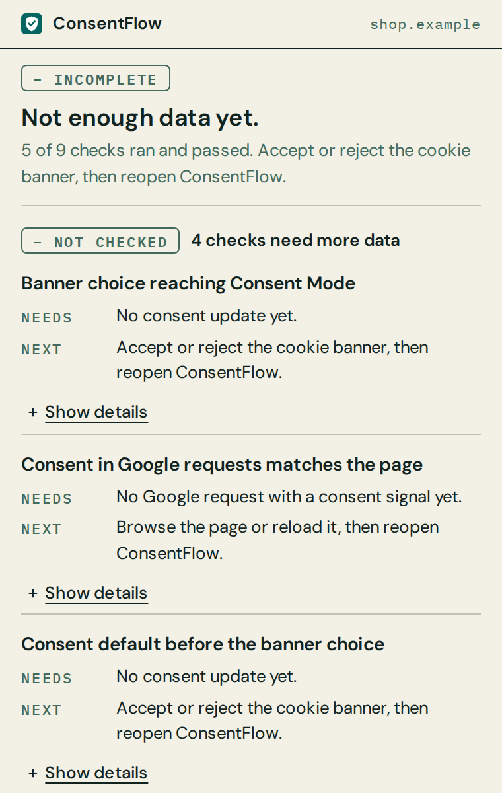
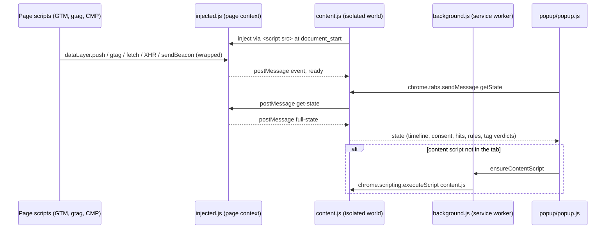

<p align="center">
  
</p>

<h1 align="center">ConsentFlow Debugger</h1>

<p align="center">
  <strong>See exactly when Google Consent Mode v2 is set, updated and sent, and catch the tags that fire before it is.</strong>
</p>

<p align="center">
  <a href="https://github.com/ChristopherLandaverde/ConsentFlow-Debugger/actions/workflows/ci.yml"></a>
  <a href="manifest.json"></a>
  <a href="LICENSE"></a>
</p>

<p align="center">
  <a href="#install">Install</a> · <a href="#how-to-use">How to use</a> · <a href="#what-it-detects">What it detects</a> · <a href="#privacy-and-permissions">Privacy</a> · <a href="https://consentflow-psi.vercel.app">Landing page</a>
</p>

ConsentFlow Debugger is a free, open-source Chrome extension (Manifest V3) for analytics
engineers, QA and consultants who need to check a Google Consent Mode v2 implementation on a
live page. It records the consent commands a page issues, decodes the consent signals in
outgoing Google requests, and flags race conditions, missing defaults and tags that send
requests while their consent is denied. All analysis happens in your browser.

<p align="center">
  
  
</p>

<p align="center">
  
  <br><sub>The recording shows the earlier four-tab popup; the screenshots above show the current one.</sub>
</p>

**Quick start** (Chrome, no build step; details under [Install](#install)):

1. `git clone https://github.com/ChristopherLandaverde/ConsentFlow-Debugger.git`
2. In `chrome://extensions/`, turn on Developer mode, click **Load unpacked** and pick the cloned folder.
3. Reload a page that uses Google Consent Mode and click the ConsentFlow icon. The first line is the verdict.

## Install

ConsentFlow Debugger is not published on the Chrome Web Store. Install it as an unpacked
extension in Chrome or another Chromium browser with Manifest V3 support.

### From source

```bash
git clone https://github.com/ChristopherLandaverde/ConsentFlow-Debugger.git
```

1. Open `chrome://extensions/`.
2. Turn on **Developer mode** (top right).
3. Click **Load unpacked** and select the cloned `ConsentFlow-Debugger` folder (the one that
   contains `manifest.json`).
4. Pin the extension from the toolbar's puzzle-piece menu so its icon is always visible.

To update, `git pull` and click the reload icon on the extension's card in
`chrome://extensions/`.

### From a release zip

When a version is published on the
[Releases page](https://github.com/ChristopherLandaverde/ConsentFlow-Debugger/releases), it
carries a zip of the extension files (`manifest.json`, `background.js`, `content.js`,
`injected.js`, `popup/`, `icons/`).

1. Download the zip and extract it to a folder you will keep.
2. Follow steps 1 to 4 above, selecting the extracted folder.

Chrome loads the extension from that folder, so don't delete it. If no zip is attached to a
release yet, install from source.

## How to use

1. Open (or reload) the page you want to check. The extension starts capturing at
   `document_start`, before Google Tag Manager loads, so a reload gives the complete picture.
   No page of your own handy? The landing page's [measurement test section](https://consentflow-psi.vercel.app/#measurement-playground)
   loads a disposable GTM container.
2. Click the ConsentFlow Debugger icon. The popup shows, top to bottom:
   - **The verdict**: one sentence with its status, `× BROKEN`, `! REVIEW`, `– INCOMPLETE` or
     `✓ VERIFIED`. With too little data it says "Not enough data yet." and names the next step.
   - **Problems**, most severe first, each with what was observed, why it matters, how to fix
     it and how to verify the fix. **Show evidence** lists the timings, requests and values
     behind it.
   - **Checks that need more data**, with what each needs and what to do next.
   - **Passed checks**, collapsed into one row.
   - **Open full trace**, which opens the side panel for this tab (below), and **Reload and
     recheck**, which reloads the tab and captures from the start.
3. Click **Open full trace**, then interact with the consent banner (accept, reject,
   customise). The side panel stays open beside the page and updates every 2 seconds without
   resetting your scroll position, focus or what you expanded. Its tabs:
   - **Findings**: the same verdict and findings as the popup.
   - **Timeline**: consent commands, `config` calls, GTM load and vendor requests in ms after
     page start, with what each consent command changed. Other dataLayer events are one click
     away.
   - **Requests**: for each vendor request, the consent it carried (for Google, its `gcs`
     consent state and `gcd` consent detail) next to the consent on the page when it was sent,
     flagged `× mismatch` when they differ. Raw `gcs`/`gcd` values are behind a toggle.
   - **Consent**: the current consent state, denied first, and the recognized CMP.

   The panel follows the active tab in its window. The popup also refreshes every 4 seconds
   while open, and both remember what you expanded (and the panel's selected tab) for each tab
   until the browser closes.

The toolbar icon shows the number of broken findings on the current tab in red (at most 4
characters, `999+` above 999). It is cleared when nothing is broken; hover the icon for the
verdict sentence. **Open full trace** needs Chrome 116 or later; on Chrome 114 and 115, open
ConsentFlow from Chrome's side panel menu instead.

When something is broken or needs review, a "Discuss a system review ↗" link appears below
everything else. Clicking it opens `https://focosys.io/review` in a new tab; no page data is
sent with it.

## What it detects

**Consent Mode commands.** Every `consent` `default` and `update` command that reaches
`dataLayer`, whether pushed directly or through `gtag()`, in both array and arguments-object
form, including entries already in `dataLayer` before the extension's script ran. Each one is
timestamped and the merged current consent state is shown.

**Race conditions.** Three kinds:

- The first `gtag('config', ...)` call compared with the consent default. If config comes
  first, the rule fails and reports how many milliseconds late the default was.
- A consent `update` captured before any `default` (or an update on a page with no default at
  all). The rule fails: a default processed after an update can override the choice the user
  already made, and tags that fire before the default run with implicit `granted` consent.
- Requests sent before consent. Each captured request records the consent state at the moment
  it was sent, from the captured consent timeline and, for Google requests, from the request's
  own `gcs` / `gcd`. A request sent while a consent type its tag needs was `denied` counts as a
  violation even if consent was granted later.

**GCS / GCD signals.** For requests to Google endpoints (Google Analytics, Google Tag Manager,
Google Ads, DoubleClick, Google Syndication), the `gcs` parameter is decoded into
`analytics_storage` / `ad_storage`, the `gcd` parameter into `ad_storage`,
`analytics_storage`, `ad_user_data` and `ad_personalization` with default/update source, and
`npa` into personalized / non-personalized. The tracking ID (`tid`) and GA4 event name (`en`)
are shown too.

**Validation rules.** Eight checks, each reported as pass, fail, warn or not checked. A check
that lacked the data it needs (no `config` call, no consent update, no Google request with a
`gcs` value, no consent default, or no supported CMP) is reported as not checked with the
reason, never as a pass:

| Rule | Checks |
|---|---|
| Consent Default Exists | A `consent` `default` command is present |
| Default Before Config | The default precedes the first `config` call (race condition) |
| Consent Mode v2 Types | The default declares `ad_user_data` and `ad_personalization` |
| `wait_for_update` Configured | When a CMP is detected, the default sets `wait_for_update` |
| Consent Update Received | At least one `consent` `update` arrived |
| GCS Signal Consistency | Each decoded `gcs` value matches the consent state at the moment the request was sent |
| No Duplicate Defaults | Only one `consent` `default` was issued |
| Default Before Update | No `consent` `update` arrived before the default (race condition) |

**Tags and tag firing violations.** Detects ten tags from page globals and script URLs (Google
Analytics 4, Google Tag Manager, Google Ads, Meta/Facebook Pixel, LinkedIn Insight, TikTok
Pixel, Hotjar, Microsoft Clarity, Pinterest Tag, Snapchat Pixel). Each tag is mapped to the
consent types it needs and to the requests captured for its vendor, then given a verdict. Each
tag finding says how many of its requests were sent while required consent was denied:

| Verdict | Meaning |
|---|---|
| `VIOLATION` | At least one request to the vendor was sent while a required consent type was `denied` at that moment, even if consent was granted later |
| `BLOCKED` | A required consent type is `denied` now and no request was sent while it was denied |
| `FIRING` | None of its required consent types is `denied`, and requests were captured, all sent after consent |
| `IDLE` | None of its required consent types is `denied`, and no requests were captured yet |
| `NO CONSENT MODE` | The page has no consent default at all |

In the popup, `VIOLATION` is a broken finding, `BLOCKED` and `FIRING` count as passed checks,
`IDLE` is not checked yet, and `NO CONSENT MODE` is reported inside the missing-default finding.

**Consent management platforms.** Cookiebot, OneTrust, IAB TCF (`__tcfapi`), CookieYes,
CookieConsent, Osano, Klaro and Cookie Information by their globals, plus Usercentrics and
iubenda by script URL.

### Known limits

- Requests are captured only when made through `fetch`, `XMLHttpRequest` or
  `navigator.sendBeacon`. Image pixels and script loads are not seen, so a vendor that only
  uses `` beacons can show as `IDLE` or `BLOCKED` while it is in fact sending data.
- Any request to a vendor sent while a required consent type was denied counts toward
  `VIOLATION`, including Google's cookieless pings under advanced Consent Mode (a request whose
  own `gcs` reports the type as denied). Check the request's `gcs` under **Show captured data** before
  treating such a violation as data collected without consent.
- Only the top-level frame is inspected; iframes are not.
- State is kept per page load. Reload the page to start a fresh capture.
- If a tab was already open when the extension was installed or reloaded, the content script
  is injected on demand but misses everything that happened earlier. Reload the tab.
- The timeline keeps the latest 300 events and the latest 200 network requests.

## Privacy and permissions

Nothing leaves your browser. The extension's own code makes no network requests: it has no
analytics, no remote configuration and no server. It stores no captured data: that lives only in
the inspected page's memory and the open popup or side panel, and is gone when the page is
closed or reloaded. The only thing it stores is UI state (which items you expanded and which
side-panel tab you picked, per tab) in `chrome.storage.session`, which Chrome keeps in memory,
never syncs, and clears when the browser closes; a tab's entries are removed when the tab closes.

Two things to know:

- The capture script runs in the page's own JavaScript context (it has to, to see
  `dataLayer` and `gtag`). Its state is exposed as `window.__cfDebug` and relayed to the
  content script with `window.postMessage`, so scripts on the inspected page can read what
  the extension captured about that page.
- To capture network requests it wraps `fetch`, `XMLHttpRequest.prototype.open` and
  `navigator.sendBeacon`, and it wraps `dataLayer.push`. If the page has no `gtag` function
  yet, it defines one that forwards to `dataLayer`, as the standard gtag snippet does. Calls are
  passed through unchanged.

What each manifest entry is for:

| Manifest entry | Why |
|---|---|
| `content_scripts` on `http://*/*` and `https://*/*`, at `document_start` | Consent defaults are often set before GTM loads, so the capture script has to be in place before any page script runs. Chrome will warn that the extension can "read and change all your data on all websites" because of this. |
| `web_accessible_resources`: `injected.js` | Lets the content script load `injected.js` into the page's context via a `<script>` tag. |
| `activeTab` | Access to the current tab when you click the toolbar icon. |
| `scripting` | Lets the background worker inject `content.js` into a tab that was already open before the extension was installed or reloaded. |
| `sidePanel` | The side panel (**Open full trace**) that shows the timeline, requests and consent state beside the page. |
| `storage` | `chrome.storage.session` only, for UI state: expanded items and the selected side-panel tab. No captured data, nothing persistent, nothing synced. |

See [SECURITY.md](SECURITY.md) for the full security model and how to report a
vulnerability privately.

## Architecture

| File | Runs in | Role |
|---|---|---|
| `injected.js` | Page context | Capture engine. Wraps `dataLayer.push`, `gtag`, `fetch`, `XMLHttpRequest`, `sendBeacon`; decodes GCS/GCD; detects CMPs and tags; runs the validation rules (500 ms after DOMContentLoaded, then every 3 s); computes tag verdicts. |
| `content.js` | Content script (isolated world), `document_start` | Injects `injected.js`, caches the latest state it posts, answers `getState` and `ping` from the popup and side panel, and reports rule and tag results to `background.js` for the badge when they change. |
| `background.js` | Service worker | Injects `content.js` into a tab that doesn't have it yet, sets the toolbar badge from the rule and tag results `content.js` reports, and forgets a closed tab's UI state. |
| `popup/findings.js` | Popup, side panel, service worker | Turns the state into findings (observed, consequence, fix, verify, evidence), one verdict, and the badge. |
| `popup/render.js`, `popup/ui-state.js` | Popup, side panel | Shared escaping and findings rendering; UI state in `chrome.storage.session`. |
| `popup/popup.js` | Extension popup | Requests state from the active tab every 4 s and renders the verdict and findings. Fonts are bundled in `popup/fonts/` (SIL Open Font License 1.1). |
| `sidepanel/panel.js` | Side panel | Requests state from the active tab every 2 s and renders findings, timeline, requests and consent, re-rendering only the views that changed. |



The repository also contains the project's landing page (`index.html`) and some older,
standalone Cookiebot helper scripts (`bookmarklet.js`, `universal-*.js`,
`website-integration.js`). None of them are part of the extension. The landing page's
deployment and measurement test section are documented in [docs/website.md](docs/website.md).

## Development and testing

Requires Node.js 22 (the version CI uses). There are no runtime or dev dependencies.

```bash
npm ci --ignore-scripts
npm test           # node --test "tests/*.test.mjs"
npm run validate   # node scripts/validate.mjs
```

`npm test` runs the real `injected.js`, `popup/findings.js` and `popup/popup.js` inside `node:vm` contexts with
a small stand-in for the page (`tests/helpers/page.mjs`) and for the popup's DOM and the
`chrome` API (`tests/helpers/popup-dom.mjs`). The test controls the clock and the timers,
so race-condition timings are exact. What is covered:

| File | Behavior tested |
|---|---|
| `tests/injected-capture.test.mjs` | Consent `default` / `update` capture via `gtag()`, array and arguments-object pushes, entries already in `dataLayer`, first-default-wins, update-before-default, GTM replacing `dataLayer.push`, a page replacing `gtag`, config calls, `gtm.js` and other events |
| `tests/injected-signals.test.mjs` | GCS, GCD and NPA decoding, `tid` / `en`, capture through `fetch`, `sendBeacon` and `XMLHttpRequest` (calls passed through unchanged), vendor attribution, non-vendor requests ignored |
| `tests/injected-rules.test.mjs` | All eight validation rules (pass, fail, warn, not checked cases), the default-before-config and update-before-default races, CMP and tag detection, the five tag verdicts judged by consent at the time of each request, the `get-state` message and the 300/200 export limits |
| `tests/findings.test.mjs` | The verdict for every state (including "Not enough data yet" with zero Google requests), finding order, and the copy model: every rule status and tag verdict has observed, consequence, fix, verify and evidence, with a copy lint |
| `tests/popup.test.mjs` | Fetching state (including the inject-and-retry path), loading, error and content states, the verdict, findings, disclosures, the review link, live refresh keeping expanded items, scroll and focus, captured data, HTML escaping, and page-to-popup runs that feed `injected.js` output into the popup |
| `tests/static-validation.test.mjs` | The `postMessage` boundary in `content.js`, landing-page checks and a committed-secret scan |

Every test runs as a real assertion; there are no `todo` or skipped tests.

`npm run validate` confirms the extension and website files exist, that `manifest.json`
declares a content script, and that every JavaScript file passes `node --check`.

Not covered by automated tests: `content.js` and `background.js` message relaying, real
Chrome behavior (loading at `document_start`, the popup's layout and CSS) and real sites.
Check those by loading the extension unpacked and trying pages with and without Consent Mode;
`tests/fixtures/popup-states.html` is a local page that produces each popup state.

## Contributing

Issues and pull requests are welcome.

1. Fork the repo and create a branch from `main`.
2. Make your change. Keep the page-context / content-script boundary: `content.js` must talk
   to `injected.js` only through `window.postMessage`.
3. Run `npm ci --ignore-scripts && npm test && npm run validate`, and add or update tests
   in `tests/` for behavior you change.
4. Load the extension unpacked, reload it after each change, and check it on a real page.
   Mention in the PR which sites or scenarios you tried.
5. Open a pull request describing what changed and why.

If you change what a rule or verdict means, explain the Consent Mode behavior it is based on.

## License

MIT. See [LICENSE](LICENSE).

Built by [Christopher Landaverde](https://focosys.io).
