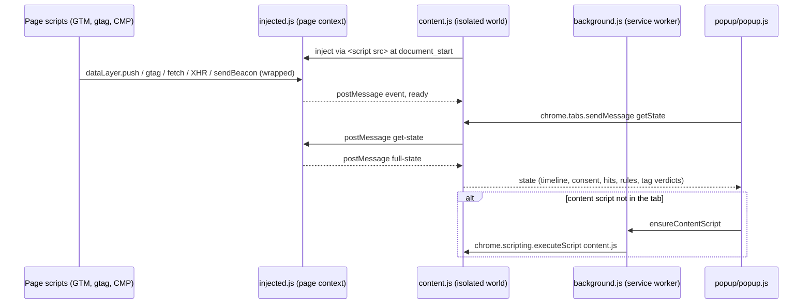

<p align="center">
  
</p>

<h1 align="center">ConsentFlow Debugger</h1>

<p align="center">
  <strong>See exactly when Google Consent Mode v2 is set, updated and sent, and catch the tags that fire before it is.</strong>
</p>

<p align="center">
  <a href="https://github.com/ChristopherLandaverde/ConsentFlow-Debugger/actions/workflows/ci.yml"></a>
  <a href="manifest.json"></a>
  <a href="LICENSE"></a>
</p>

ConsentFlow Debugger is a free, open-source Chrome extension (Manifest V3) for analytics
engineers, QA and consultants who need to check a Google Consent Mode v2 implementation on a
live page. It records the consent commands a page issues, decodes the consent signals in
outgoing Google requests, and flags race conditions, missing defaults and tags that send
requests while their consent is denied. All analysis happens in your browser.

<!--
  DEMO: add a screenshot of the popup on a real Consent Mode site and a short GIF here,
  committed under docs/media/. Example:

  <p align="center">
    
  </p>
-->

## What it detects

**Consent Mode commands.** Every `consent` `default` and `update` command that reaches
`dataLayer`, whether pushed directly or through `gtag()`, in both array and arguments-object
form, including entries already in `dataLayer` before the extension's script ran. Each one is
timestamped and the merged current consent state is shown.

**Race conditions.** The time of the first `gtag('config', ...)` call compared with the
consent default. If config comes first, the rule fails and reports how many milliseconds late
the default was.

**GCS / GCD signals.** For requests to Google endpoints (Google Analytics, Google Tag Manager,
Google Ads, DoubleClick, Google Syndication), the `gcs` parameter is decoded into
`analytics_storage` / `ad_storage`, the `gcd` parameter into `ad_storage`,
`analytics_storage`, `ad_user_data` and `ad_personalization` with default/update source, and
`npa` into personalized / non-personalized. The tracking ID (`tid`) and GA4 event name (`en`)
are shown too.

**Validation rules.** Seven checks, each reported as pass, fail, warn or info with an explanation:

| Rule | Checks |
|---|---|
| Consent Default Exists | A `consent` `default` command is present |
| Default Before Config | The default precedes the first `config` call (race condition) |
| Consent Mode v2 Types | The default declares `ad_user_data` and `ad_personalization` |
| `wait_for_update` Configured | When a CMP is detected, the default sets `wait_for_update` |
| Consent Update Received | At least one `consent` `update` arrived |
| GCS Signal Consistency | Each decoded `gcs` value matches the current consent state |
| No Duplicate Defaults | Only one `consent` `default` was issued |

**Tags and tag firing violations.** Detects ten tags from page globals and script URLs (Google
Analytics 4, Google Tag Manager, Google Ads, Meta/Facebook Pixel, LinkedIn Insight, TikTok
Pixel, Hotjar, Microsoft Clarity, Pinterest Tag, Snapchat Pixel). Each tag is mapped to the
consent types it needs and to the requests captured for its vendor, then given a verdict:

| Verdict | Meaning |
|---|---|
| `VIOLATION` | A required consent type is `denied`, yet requests to the vendor were captured |
| `BLOCKED` | A required consent type is `denied` and no requests were captured |
| `FIRING` | None of its required consent types is `denied`, and requests were captured |
| `IDLE` | None of its required consent types is `denied`, and no requests were captured yet |
| `NO CONSENT MODE` | The page has no consent default at all |

An overall grade (Critical, Not implemented, Partial, Good) summarises the verdicts.

**Consent management platforms.** Cookiebot, OneTrust, IAB TCF (`__tcfapi`), CookieYes,
CookieConsent, Osano, Klaro and Cookie Information by their globals, plus Usercentrics and
iubenda by script URL.

### Known limits

- Requests are captured only when made through `fetch`, `XMLHttpRequest` or
  `navigator.sendBeacon`. Image pixels and script loads are not seen, so a vendor that only
  uses `` beacons can show as `IDLE` or `BLOCKED` while it is in fact sending data.
- Only the top-level frame is inspected; iframes are not.
- State is kept per page load. Reload the page to start a fresh capture.
- If a tab was already open when the extension was installed or reloaded, the content script
  is injected on demand but misses everything that happened earlier. Reload the tab.
- The timeline keeps the latest 300 events and the latest 200 network requests.

## Install

ConsentFlow Debugger is not published on the Chrome Web Store. Install it as an unpacked
extension in Chrome or another Chromium browser with Manifest V3 support.

### From source

```bash
git clone https://github.com/ChristopherLandaverde/ConsentFlow-Debugger.git
```

1. Open `chrome://extensions/`.
2. Turn on **Developer mode** (top right).
3. Click **Load unpacked** and select the cloned `ConsentFlow-Debugger` folder (the one that
   contains `manifest.json`).
4. Pin the extension from the toolbar's puzzle-piece menu so its icon is always visible.

To update, `git pull` and click the reload icon on the extension's card in
`chrome://extensions/`.

### From a release zip

When a version is published on the
[Releases page](https://github.com/ChristopherLandaverde/ConsentFlow-Debugger/releases), it
carries a zip of the extension files (`manifest.json`, `background.js`, `content.js`,
`injected.js`, `popup/`, `icons/`).

1. Download the zip and extract it to a folder you will keep.
2. Follow steps 1 to 4 above, selecting the extracted folder.

Chrome loads the extension from that folder, so don't delete it. If no zip is attached to a
release yet, install from source.

## How to use

1. Open (or reload) the page you want to check. The extension starts capturing at
   `document_start`, before Google Tag Manager loads, so a reload gives the complete picture.
2. Click the ConsentFlow Debugger icon. The header shows the number of failed rules or warnings,
   and a scorecard shows rules passed, tags detected, requests captured and the detected CMP.
3. Use the four tabs:
   - **Flow**: the timeline of consent defaults, consent updates, `config` calls, GTM load and
     vendor requests, with millisecond timestamps.
   - **Rules**: the seven validation rules, failures first.
   - **Network**: captured vendor requests with decoded GCS, GCD and NPA.
   - **State**: current consent values, detected CMP, implementation grade and tag verdicts.
4. Interact with the consent banner (accept, reject, customise) and watch the popup. It
   refreshes every 4 seconds; **Refresh** fetches immediately.

When there are failures or warnings, the popup shows a "Book a free 30-min review" button.
Clicking it opens `https://focosys.io/review` in a new tab; no page data is sent with it.

## Privacy and permissions

Nothing leaves your browser. The extension's own code makes no network requests: it has no
analytics, no remote configuration and no server. It does not use `chrome.storage` or any other
persistent storage; captured data lives only in the inspected page's memory and the open popup,
and is gone when the page is closed or reloaded.

Two things to know:

- The capture script runs in the page's own JavaScript context (it has to, to see
  `dataLayer` and `gtag`). Its state is exposed as `window.__cfDebug` and relayed to the
  content script with `window.postMessage`, so scripts on the inspected page can read what
  the extension captured about that page.
- To capture network requests it wraps `fetch`, `XMLHttpRequest.prototype.open` and
  `navigator.sendBeacon`, and it wraps `dataLayer.push`. If the page has no `gtag` function
  yet, it defines one that forwards to `dataLayer`, as the standard gtag snippet does. Calls are
  passed through unchanged.

What each manifest entry is for:

| Manifest entry | Why |
|---|---|
| `content_scripts` on `http://*/*` and `https://*/*`, at `document_start` | Consent defaults are often set before GTM loads, so the capture script has to be in place before any page script runs. Chrome will warn that the extension can "read and change all your data on all websites" because of this. |
| `web_accessible_resources`: `injected.js` | Lets the content script load `injected.js` into the page's context via a `<script>` tag. |
| `activeTab` | Access to the current tab when you click the toolbar icon. |
| `scripting` | Lets the background worker inject `content.js` into a tab that was already open before the extension was installed or reloaded. |

## Architecture

| File | Runs in | Role |
|---|---|---|
| `injected.js` | Page context | Capture engine. Wraps `dataLayer.push`, `gtag`, `fetch`, `XMLHttpRequest`, `sendBeacon`; decodes GCS/GCD; detects CMPs and tags; runs the validation rules (500 ms after DOMContentLoaded, then every 3 s); computes tag verdicts. |
| `content.js` | Content script (isolated world), `document_start` | Injects `injected.js`, caches the latest state it posts, and answers the popup's `getState` and `ping` messages. |
| `background.js` | Service worker | On request from the popup, injects `content.js` into a tab that doesn't have it yet. |
| `popup/` | Extension popup | Requests state from the active tab every 4 s and renders the scorecard and the Flow, Rules, Network and State tabs. |



The repository also contains the project's landing page (`index.html`) and some older,
standalone Cookiebot helper scripts (`bookmarklet.js`, `universal-*.js`,
`website-integration.js`). None of them are part of the extension. The landing page's
deployment and measurement test section are documented in [docs/website.md](docs/website.md).

## Development and testing

Requires Node.js 22 (the version CI uses). There are no runtime or dev dependencies.

```bash
npm ci --ignore-scripts
npm test           # node --test tests/static-validation.test.mjs
npm run validate   # node scripts/validate.mjs
```

What these check today:

- `npm run validate` confirms the extension and website files exist, that `manifest.json`
  declares a content script, and that every JavaScript file passes `node --check` (syntax
  only).
- `npm test` runs `tests/static-validation.test.mjs`: static checks on source text. One test
  covers the extension (the content script talks to the page only through `postMessage`); the
  rest cover the landing page (GTM container, smoke form, measurement playground, checklist
  PDF, page size) and scan the tree for committed secrets.

The other test scripts in `package.json` (`test:architecture`, `test:integration`, `test:e2e`,
`test:performance`, `lint:security`) currently run that same file, and so do the CI jobs named
after them. There are no behavioral tests yet for consent capture, GCS/GCD decoding, the
validation rules or the popup; they are in progress. Until then, test changes by loading the
extension unpacked and checking it against real pages with and without Consent Mode.

## Contributing

Issues and pull requests are welcome.

1. Fork the repo and create a branch from `main`.
2. Make your change. Keep the page-context / content-script boundary: `content.js` must talk
   to `injected.js` only through `window.postMessage`.
3. Run `npm ci --ignore-scripts && npm test && npm run validate`.
4. Load the extension unpacked, reload it after each change, and check it on a real page.
   Mention in the PR which sites or scenarios you tried.
5. Open a pull request describing what changed and why.

If you change what a rule or verdict means, explain the Consent Mode behavior it is based on.

## License

MIT. See [LICENSE](LICENSE).

Built by [Christopher Landaverde](https://focosys.io).
