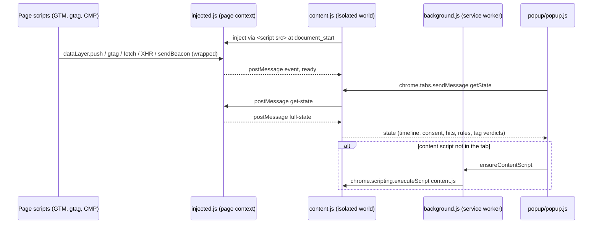

# Architecture

How the extension is put together, for anyone changing it. See also [AGENTS.md](../AGENTS.md) for conventions and [development.md](development.md) for tests.

| File | Runs in | Role |
|---|---|---|
| `injected.js` | Page context | Capture engine. Wraps `dataLayer.push`, `gtag`, `fetch`, `XMLHttpRequest`, `sendBeacon`; decodes GCS/GCD; detects CMPs and tags; runs the validation rules (500 ms after DOMContentLoaded, then every 3 s); computes tag verdicts. |
| `content.js` | Content script (isolated world), `document_start` | Injects `injected.js`, caches the latest state it posts, answers `getState` and `ping` from the popup and side panel, and reports rule and tag results to `background.js` for the badge when they change. |
| `background.js` | Service worker | Injects `content.js` into a tab that doesn't have it yet, sets the toolbar badge from the rule and tag results `content.js` reports, and forgets a closed tab's UI state. |
| `popup/findings.js` | Popup, side panel, service worker | Turns the state into findings (observed, consequence, fix, verify, evidence), one verdict, and the badge. |
| `popup/render.js`, `popup/ui-state.js` | Popup, side panel | Shared escaping and findings rendering; UI state in `chrome.storage.session`. |
| `popup/popup.js` | Extension popup | Requests state from the active tab every 4 s and renders the verdict and findings. Fonts are bundled in `popup/fonts/` (SIL Open Font License 1.1). |
| `sidepanel/panel.js` | Side panel | Requests state from the active tab every 2 s and renders findings, timeline, requests and consent, re-rendering only the views that changed. |

The repository also contains the project's landing page (`index.html`) and some older,
standalone Cookiebot helper scripts (`bookmarklet.js`, `universal-*.js`,
`website-integration.js`). None of them are part of the extension. The landing page's
deployment and measurement test section are documented in [docs/website.md](website.md).
